# 3D Claude Office — AI Agent Company Simulator

> 「我不是在跟 9 個 AI 聊天，我是在管理一間有 9 個 AI 員工的公司。」

一個 Web-first 的 3D AI 公司模擬器 MVP。你是 **Owner**，只透過 **Director** 管理公司；Director 把工作拆給 **Managers**，Managers 再分派給 **Employees**。每位 Agent 的工作狀態會即時反映在 3D 辦公室裡：坐在電腦前、走去會議室、到主管桌前回報、去休息區。

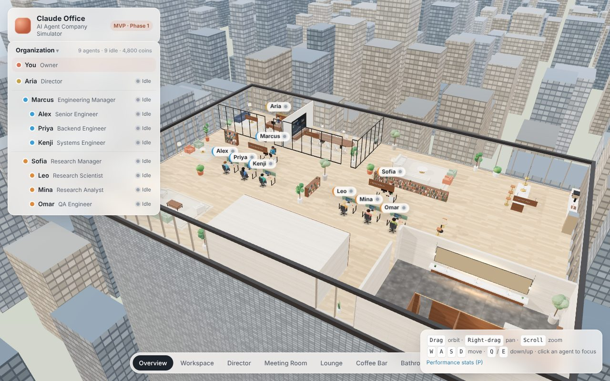

## 目前進度

| Phase | 內容 | 狀態 |
| --- | --- | --- |
| 1 | Project setup · 3D scene · Office layout · Static agents | ✅ 完成 |
| 2 | Agent data · Click UI · Status UI（＋辦公室貓 Mochi） | ✅ 完成 |
| 3 | Task engine · Director delegation · Mock Agent Provider（＋Event stream、SQLite） | ✅ 完成 |
| 4 | Movement（Event system 已在 Phase 3 完成） | ⏭️ 下一步 |
| 5 | Performance · Coins · Dashboard | 🔜 |
| 6 | Polish · Premium office · Lighting · Camera | 🔜 |

詳細清單見 [docs/mvp.md](docs/mvp.md)。

## Quick start

需要 Node.js ≥ 20.19（建議 22）。

```bash
npm install
```

```bash
npm run dev
```

打開 http://localhost:5173 。

`npm run dev` 會同時啟動兩個服務：

- **server**：Fastify API + 事件串流，`:8787`。啟動前會自動 `prisma generate && prisma db push`，第一次會建立 `apps/server/office.db`。
- **web**：Vite，`:5173`，`/api` 會 proxy 到 server。

不需要任何 API key：預設使用 Mock LLM provider。

在 Director Chat 點建議的 Demo 題目，或輸入：

> Analyze random write performance bottleneck and propose improvements.

約 40 秒後 Director 會交回最終報告。想看快一點：

```bash
SIM_SPEED=2 npm run dev
```

其他指令：

```bash
npm test            # 在記憶體中以 40 倍速跑完整 Demo 流程（agent runtime）
```

```bash
npm run typecheck   # 全部 workspace 型別檢查
```

```bash
npm run build && npm start   # production：單一 port http://localhost:8787 同時提供 API 與前端
```

環境變數（全部可選）：`SIM_SPEED`（模擬倍速）、`LLM_PROVIDER`（目前只有 `mock`）、`MOCK_BLOCK_RATE`、`PORT`、`DATABASE_URL`，說明見 [architecture.md §4](docs/architecture.md)。

## 操作

| 操作 | 效果 |
| --- | --- |
| 左鍵拖曳 | 環繞視角 |
| 右鍵拖曳 | 平移 |
| 滾輪 | 縮放 |
| `W` `A` `S` `D` / 方向鍵 | 移動視角 |
| `Q` / `E` | 下降 / 上升 |
| 點擊 3D 中的 Agent，或左側 Roster | 鏡頭飛到該 Agent，右側打開 Agent Panel |
| 點擊 3D 中的貓 | 打開 Mochi 的資訊卡（Pet / Follow） |
| 點擊空白處 / `Esc` | 關閉 Panel、停止跟隨 |
| 滑過 Roster 的 Agent | 3D 中亮出該 Agent 的部門光圈 |
| 底部 View bar | Overview · Workspace · Director · Meeting Room · Lounge · Coffee Bar · Bathroom · City View |
| `P` | 效能統計（FPS / draw calls / triangles） |
| 右下 `?` | 顯示操作說明 |

開場會有一段鏡頭從城市上空飛進辦公室的動畫，點擊或拖曳可略過。

右下 `?` 裡也有 **Reset company**：清空所有專案、任務與聊天，回到初始狀態。

開發用：網址加上 `?nav`（例如 http://localhost:5173/?nav）會畫出走道導航圖（青色）與目的地支線（粉紅）。

## Phase 3 內容：Director 委派

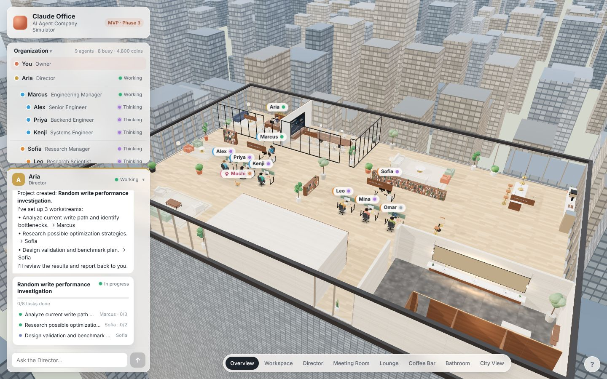

1. **Director Chat**（左下）：你只跟 Aria 對話。她回覆「Understood. I am creating a project and assigning work.」，接著：
   - 建立 Project。
   - 召集 Managers 開 kickoff meeting（狀態 Meeting）。
   - 把 3 個工作流交給 Marcus 與 Sofia。
   - Chat 中出現**即時更新的 Project card**。
2. **Managers** 把工作流拆成子任務分給團隊：Marcus → Alex / Priya / Kenji；Sofia → Leo / Mina，QA 任務交給 Omar。
3. **Employees**：
   - Thinking（準備）→ Working（執行，螢幕顯示 code / 文件）→ Reporting（回報主管）→ Idle。
   - Kenji 會遇到一次 **Blocked**（需要 benchmark 主機的 root 權限），5 秒後重試。
4. **Manager review**：子任務全部完成後，Manager review 並向 Director 回報。
5. **Director 整合**：工作流全部完成後，Director 整合成最終報告，在 Chat 回覆 Owner，並跳出「**Project Completed**」通知。

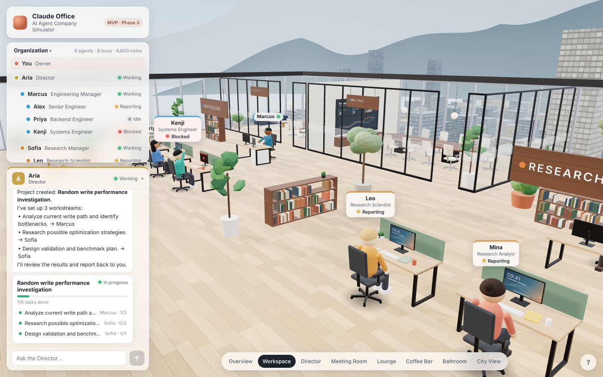

- **所有狀態都來自 server**：
  - 事件經 SSE 串流到瀏覽器，3D 名牌、螢幕、姿勢、Roster、Panel 用同一個 reducer 更新。
  - 多個分頁看到的是同一間公司。
  - 重新整理頁面不會遺失任何東西（SQLite）。
  - Server 重啟後會接手未完成的任務。
- **Agent Panel 按鈕全部可用**：
  - **Chat**：開啟和該 Agent 的對話，他會回報手上或剛完成的任務。
  - **Assign Task**：直接指派（標題、細節、優先度）；完成後該 Agent 會在對話中回報。指派給 Director 等於開新專案。
  - **Reward +100**：寫入資料庫。
  - **View Task**：查看任務。
- **Task view**：狀態、優先度、Reward、Assignee、上層任務與專案、子任務清單、結果全文。可從 Project card、Agent Panel、Recent tasks 點進去。
- 問 Director「What's the status?」會得到依實際任務計算的進度（含 Blocked 項目）。

| | |
| --- | --- |
| 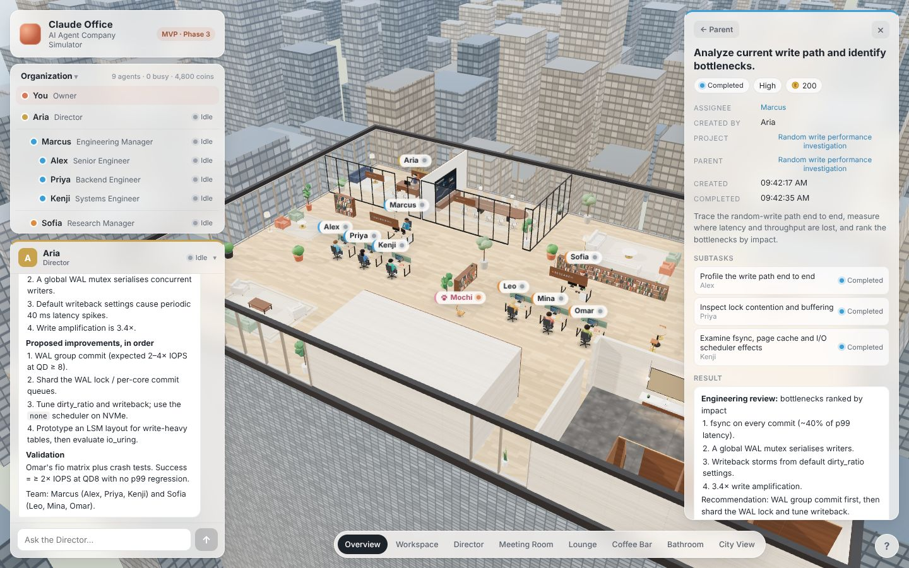 |  |

### API

| Method | Path | 說明 |
| --- | --- | --- |
| `GET` | `/api/state` | 公司快照 + `seq` |
| `GET` | `/api/events?after=seq` | SSE 事件串流（自動重連、補送） |
| `POST` | `/api/agents/:id/messages` | Owner 對 Agent 說話 `{ text }` |
| `POST` | `/api/agents/:id/tasks` | 指派任務 `{ title, description?, priority? }` |
| `POST` | `/api/agents/:id/reward` | Reward `{ coins }` |
| `POST` | `/api/admin/reset` | 重設公司 |

## Phase 2 內容

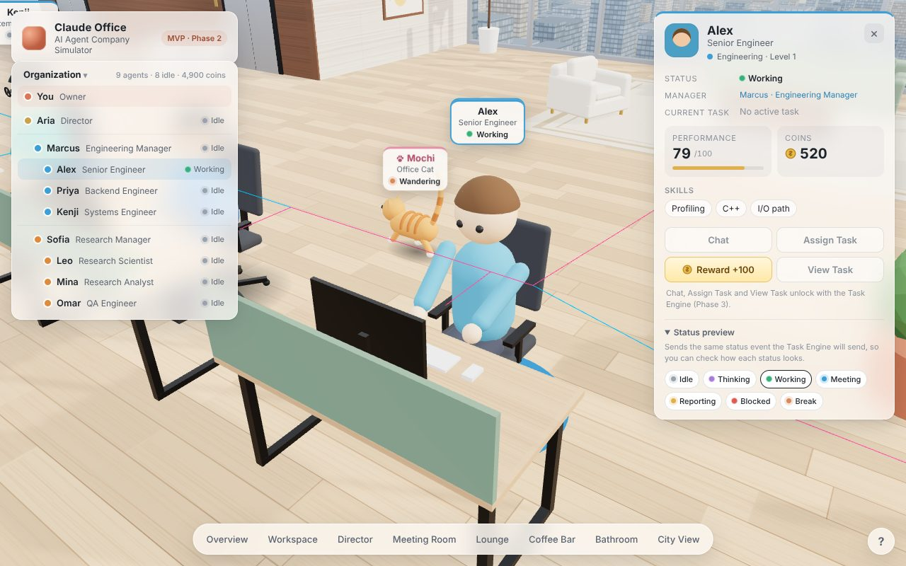

- **Agent Panel**（點擊任一 Agent）：Name、Role、Department / Level、Manager（可點擊跳過去）、Skills、Status、Current Task、Performance（進度條）、Coins（數字動畫）、Team（Manager 才有）。
- **按鈕**：Reward +100 會讓 Coins 增加，3D 中浮出「+100 Coins」，Agent 舉手歡呼。Chat、Assign Task、View Task 在 Phase 3 開放。
- **Status UI**：Roster、Panel、3D 名牌共用同一套狀態色與動畫，3D 角色也會跟著狀態改變：

  | Status | 3D |
  | --- | --- |
  | Idle | 坐著放鬆、偶爾張望，螢幕待機桌布 |
  | Thinking | 手托下巴，螢幕切成文件 |
  | Working | 打字動畫，工程師螢幕顯示 code、研究員顯示文件 |
  | Blocked | 抱頭、地上紅色警示光圈閃爍、名牌變紅、螢幕顯示 BLOCKED |
  | Meeting / Reporting / Break | Phase 4 才會移動到會議室 / 主管桌 / 休息區；目前名牌與 Panel 會更新 |

- **Status preview**（開發用）：Panel 底部可手動切換狀態，送出和 Task Engine 相同的 `AGENT_STATUS_CHANGED` 事件，用來檢查每種狀態的樣子。

| | |
| --- | --- |
| 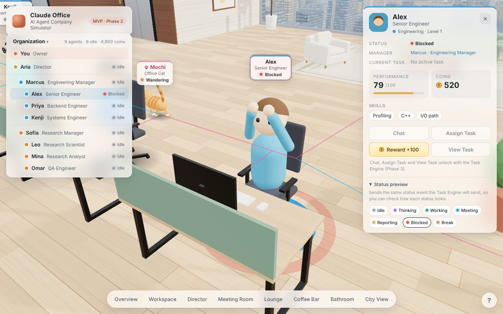 | 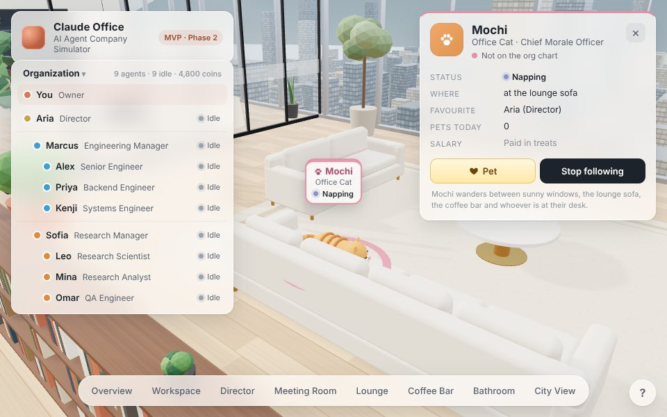 |

## 辦公室貓 Mochi 🐈

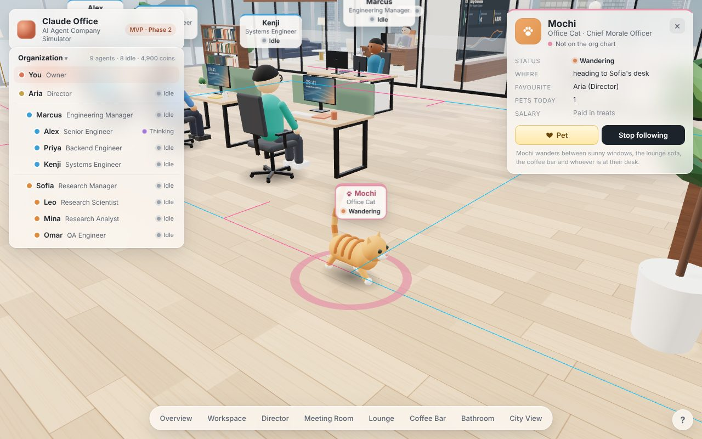

橘色虎斑貓，不在組織圖上，職稱是 Chief Morale Officer（薪水用零食支付）。

- 沿著走道導航圖自己走動，會去的地方：西側窗邊曬太陽、Lounge 沙發午睡（會跳上沙發）、北側窗邊看城市、Coffee Bar 討零食、接待區地毯，以及拜訪每位 Agent 的座位（會坐在旁邊看著他）。
- 點擊 Mochi 打開資訊卡，顯示目前在做什麼、在哪裡。
  - **Pet**：Mochi 會發出呼嚕聲、尾巴快速擺動。
  - **Follow**：鏡頭跟著 Mochi 走，期間仍可以旋轉與縮放；按 WASD、`Esc` 或選擇任一視角就會停止跟隨。
- 這套導航圖（`apps/web/src/world/navigation.ts`）也是 Phase 4 Agent 走動要用的基礎。

## Phase 1 內容

- **一層樓 penthouse office**（離地約 160m）：Open Workspace（兩個團隊 pod）、玻璃 Director Office、Meeting Room（11 席 + 大螢幕）、Lounge、Coffee Bar、Reception + 電梯核心（品牌背光牆）、Premium Bathroom。
- **Premium Bathroom**：石材牆面、深色石材地板、木質隔間（一間門半開）、懸浮大理石洗手台 + 3 個 vessel sink + 黃銅龍頭、大型鏡面（進入浴室時為真實反射）、背光鏡面光暈與檯下間接燈、智慧馬桶造型、毛巾架、植物。
- **窗外景觀**：落地窗、漸層天空與太陽光暈、約 1,700 棟 instanced 城市大樓、西側海面、北側兩層山脈、雲、大氣霧。全部 procedural，沒有下載任何 HDRI 或模型。
- **9 位 Agent**：Director 1、Managers 2、Employees 6。Stylized avatar 各有不同外觀，名牌顯示 Name / Role / Status，並依距離切換詳細程度。
- **Asset abstraction**：所有家具都透過 `AssetProvider` 取得，之後可換成 GLTF / Blender / AI 生成模型。

| | |
| --- | --- |
| 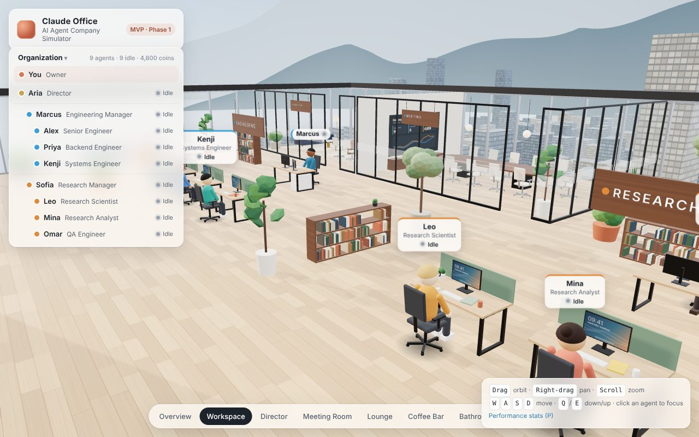 | 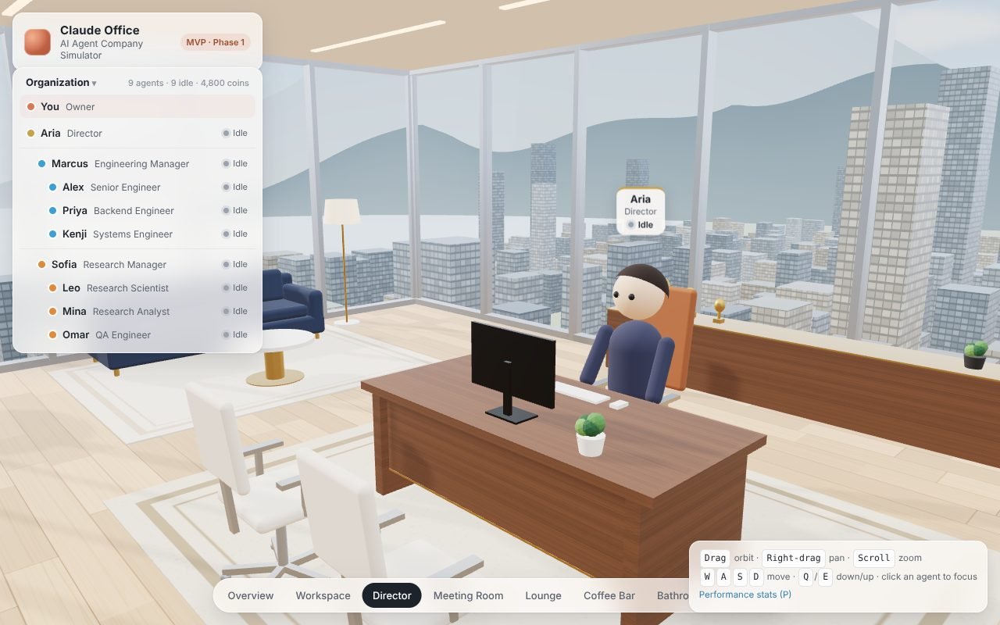 |
| 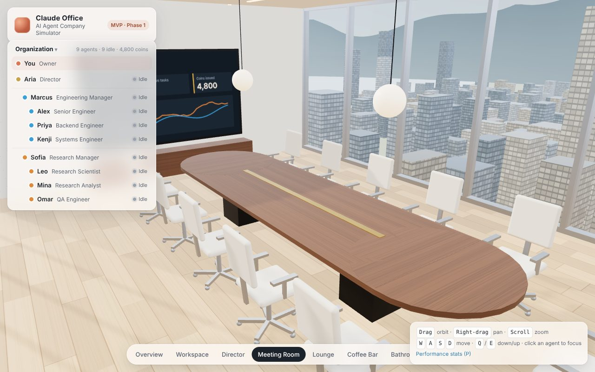 | 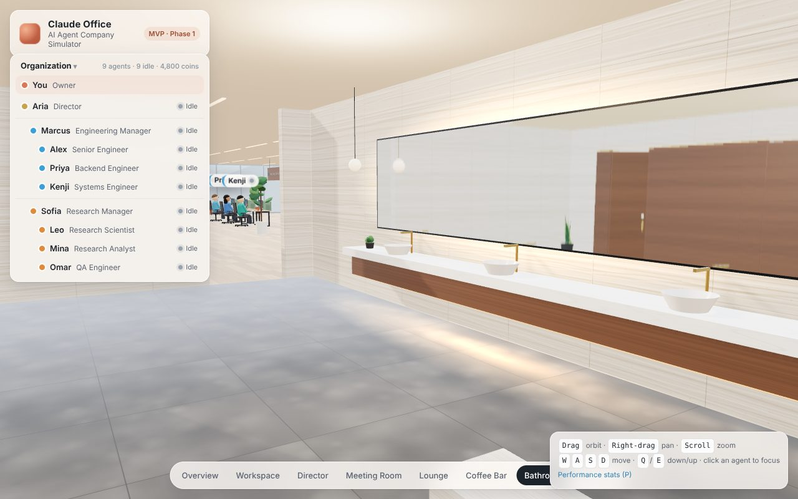 |
| 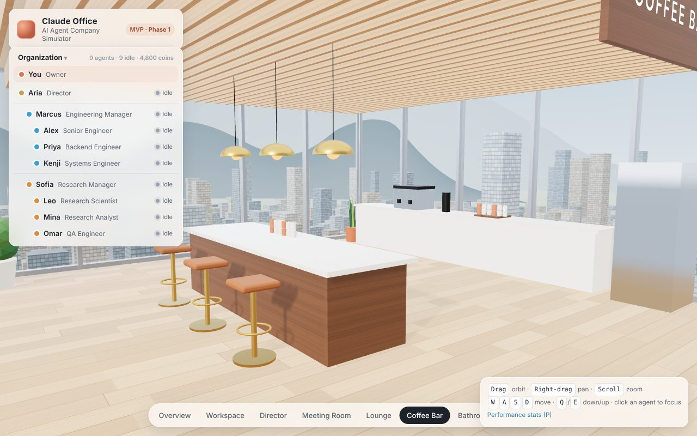 | 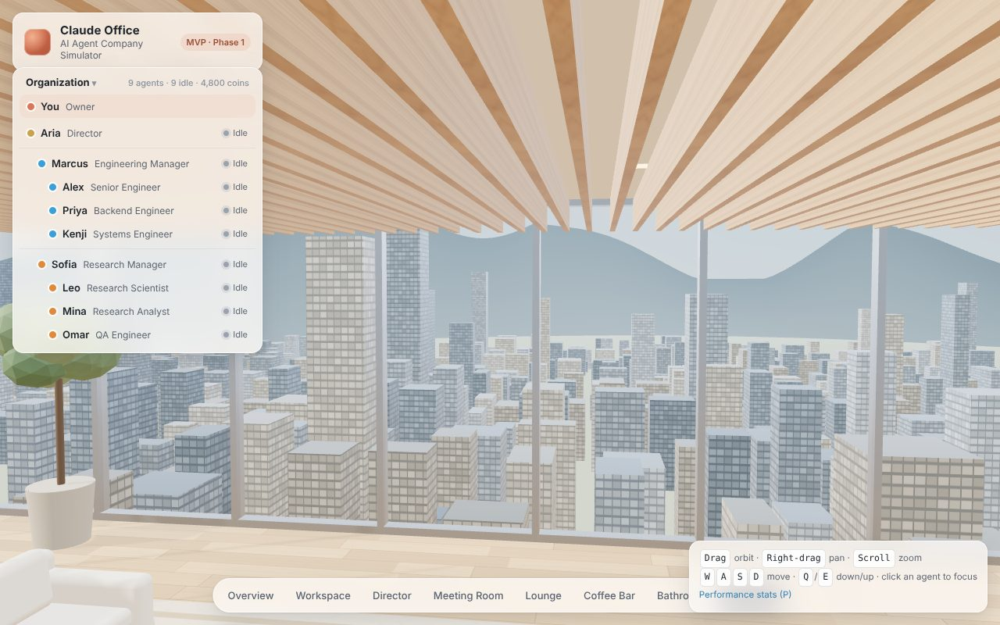 |

> 截圖由 headless Chromium（軟體 GL）產生，實際 GPU 上會更銳利。

## 組織

```
Owner (You)
└─ Aria · Director
   ├─ Marcus · Engineering Manager
   │  ├─ Alex  · Senior Engineer
   │  ├─ Priya · Backend Engineer
   │  └─ Kenji · Systems Engineer
   └─ Sofia · Research Manager
      ├─ Leo   · Research Scientist
      ├─ Mina  · Research Analyst
      └─ Omar  · QA Engineer
```

資料來源：[`packages/shared/src/org.ts`](packages/shared/src/org.ts)。

## Repository 結構

```
3d-office/
├─ apps/
│  ├─ web/                    ✅ React + Vite + React Three Fiber
│  │  └─ src/
│  │     ├─ world/            辦公室場景：layout、building、rooms、lighting、exterior、navigation、cat/
│  │     ├─ agents/           Avatar（狀態姿勢）、名牌與浮動特效投影、狀態色、外觀
│  │     ├─ assets/           AssetProvider、procedural 家具、材質、canvas textures
│  │     ├─ camera/           開場飛入、預設視角、Orbit + WASD
│  │     ├─ store/            Zustand store（快照 + SSE，套用共用 reducer）
│  │     ├─ net/              API client、事件串流
│  │     └─ ui/               HUD（Roster、Director Chat、Agent / Task / Cat Panel、Toasts、Stats）
│  └─ server/                 ✅ Fastify API、SSE、事件管線、SQLite 持久化、重啟恢復
├─ packages/
│  ├─ shared/                 ✅ 型別、OfficeEvent、reduceEvent、組織 seed、座位
│  ├─ agent-runtime/          ✅ Director / Manager / Employee 行為（含 Demo 流程測試）
│  ├─ task-engine/            ✅ 任務狀態機、建立專案 / 任務、roll-up
│  └─ llm-provider/           ✅ LLMProvider 介面 + Mock provider（Claude / OpenAI 待加入）
├─ assets/                    之後放 GLTF / texture（目前全部 procedural）
├─ prisma/                    ✅ SQLite schema（Prisma 7）
└─ docs/
   ├─ architecture.md
   ├─ agent-flow.md
   └─ mvp.md
```

6 個 npm workspace，各 package 直接 export TypeScript source，不需要 build step。依賴方向：`shared` ← `llm-provider`、`task-engine` ← `agent-runtime` ← `server`；web 只依賴 `shared`。

## Tech stack

| 層 | 技術 |
| --- | --- |
| Frontend | React 19, TypeScript, Vite |
| 3D | three.js, React Three Fiber, @react-three/drei |
| State | Zustand |
| Backend | Node.js 22, TypeScript（tsx）, Fastify 5, Server-Sent Events |
| Database | SQLite + Prisma 7（better-sqlite3 driver adapter） |
| AI | Provider abstraction：Mock（預設，已實作）、Claude / OpenAI（介面已定，待實作） |

## 效能

目標：桌機 Chrome 約 60 FPS。Phase 1 全景約 620 draw calls / 310k triangles。主要手段：

- shadow map 只算一次後凍結（baked）
- 只有 1 個投影光源，其他用 Lightformer IBL
- 城市大樓、窗框、燈條、木格柵用 instancing
- 椅子、桌框、螢幕、植物、書櫃合併 geometry
- 天花板在俯瞰時自動隱藏
- 真鏡面反射只在進入浴室時開啟

詳見 [docs/architecture.md §3.5](docs/architecture.md)。

## Docs

- [Architecture](docs/architecture.md)：Frontend、Backend、Agent Runtime、Task Engine、Event Bus、Database、3D World、LLM Provider（含 Mermaid 圖）
- [Agent Flow](docs/agent-flow.md)：組織圖、任務拆解、時序圖、狀態機、Status → 3D 對照、計分公式
- [MVP Plan](docs/mvp.md)：驗證目標、各 Phase checklist、Demo flow、不做的項目
