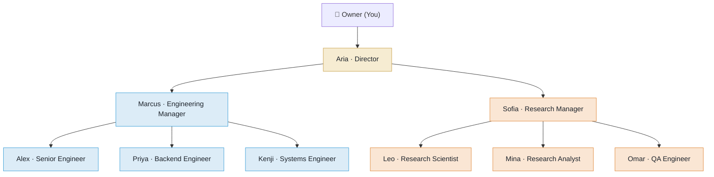
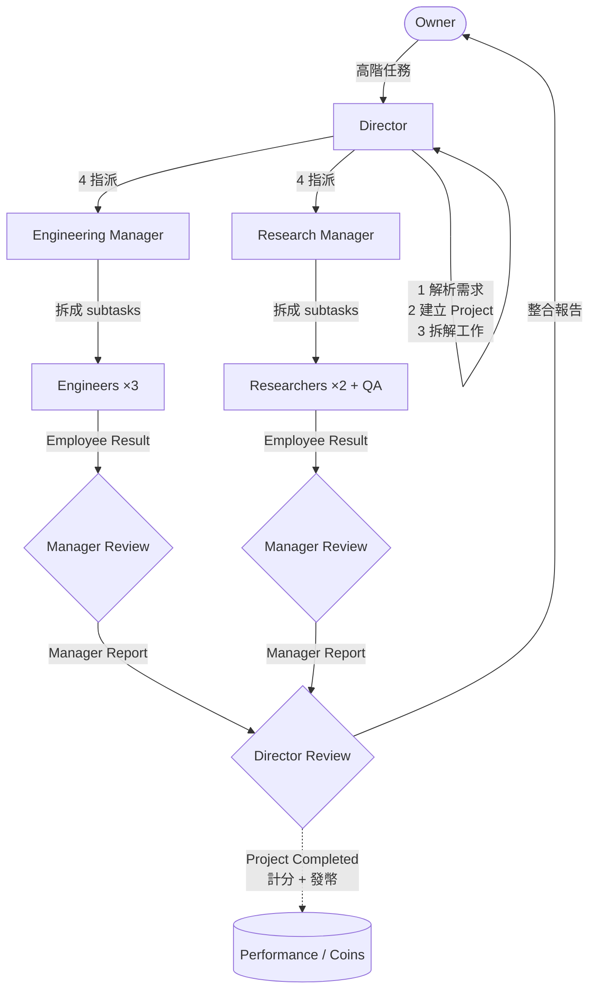
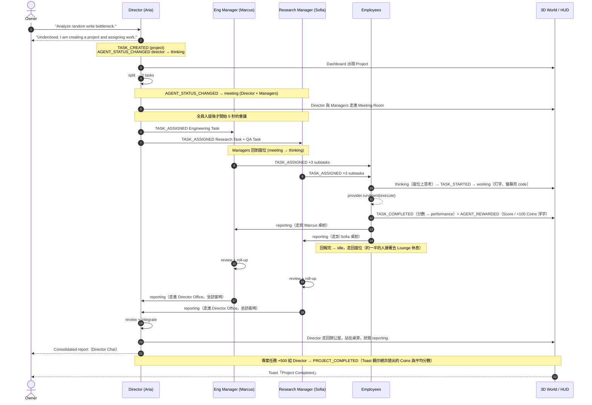
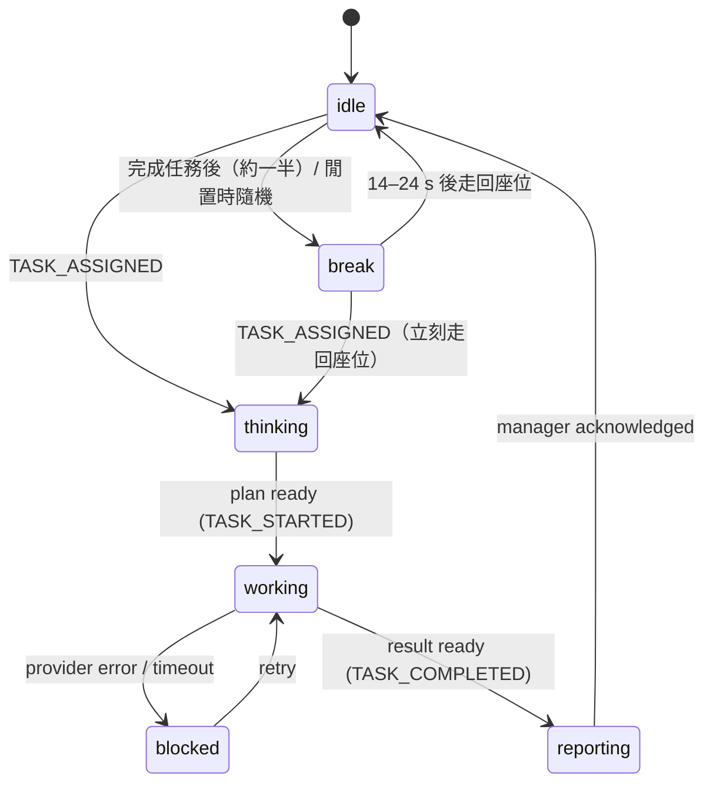
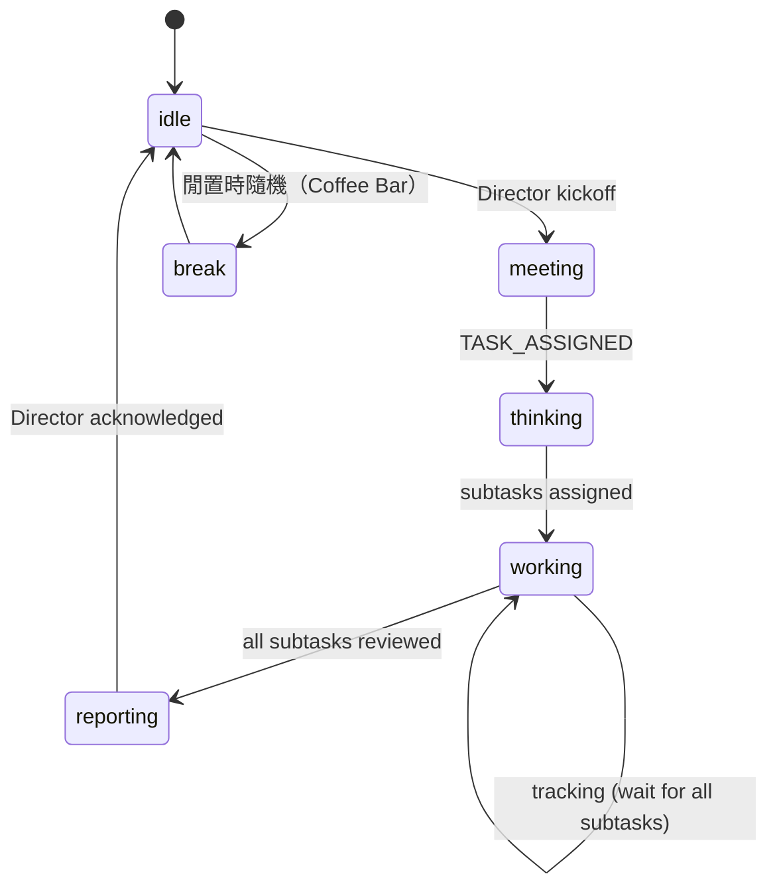
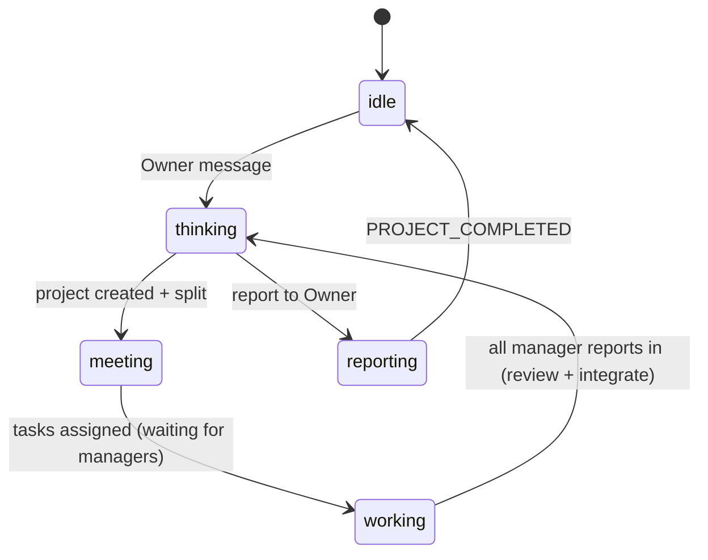

# Agent Flow — Director → Manager → Employee

> 任務流程在 Phase 3 實作（`packages/agent-runtime`，測試見 `packages/agent-runtime/test/demo.test.ts`）；Agent 走動在 Phase 4 實作（目的地與路徑：`packages/shared/src/world.ts`）；計分與發幣在 Phase 5 實作（`packages/shared/src/scoring.ts`）。

## 1. 組織圖



規則：

- **Owner 只跟 Director 對話。** 其他 Agent 只能被點擊查看、手動 Reward 或直接指派（進階操作）。
- 任務只能「往下一層」指派；結果只能「往上一層」回報。

## 2. 任務往下、結果往上



## 3. Demo 任務拆解

Owner 對 Director 說：

> "Analyze random write performance bottleneck and propose improvements."

| 層級 | 任務 | 指派給 | Priority / Reward |
| --- | --- | --- | --- |
| Project | Random write performance investigation | Aria (Director) | critical / 500 |
| Engineering Task | Analyze current write path and identify bottlenecks. | Marcus | high / 200 |
| ↳ subtask | Profile the write path end-to-end (flame graph, syscall trace). | Alex | medium / 100 |
| ↳ subtask | Inspect lock contention, buffering and cache behaviour. | Priya | medium / 100 |
| ↳ subtask | Examine fsync, page cache and I/O scheduler effects. | Kenji | medium / 100 |
| Research Task | Research possible optimization strategies. | Sofia | high / 200 |
| ↳ subtask | Survey log-structured / LSM techniques and write batching. | Leo | medium / 100 |
| ↳ subtask | Collect benchmark data and industry comparisons. | Mina | medium / 100 |
| QA Task | Design validation and benchmark plan. | Sofia → Omar | high / 200 |
| ↳ subtask | Write the fio benchmark matrix and regression criteria. | Omar | medium / 100 |

（QA Agent 隸屬 Research Manager，所以 QA Task 由 Sofia 轉派給 Omar。）

Mock provider 的 Demo 內容裡，Kenji 第一次執行時會遇到 Blocked（「Needs root access on the benchmark host to change the I/O scheduler.」），5 秒後重試完成，用來展示 Blocked 狀態。

Owner 的其他互動：

- **問 Director 進度**（含 status / progress / 進度）：依實際任務回報完成數與 Blocked 項目，不會開新專案。
- **問候**（hi / 你好 …）：一般聊天回覆。
- **和其他 Agent 對話**（Agent Panel → Chat）：他會說明手上或最近完成的任務，但不會因此開始新工作。
- **Assign Task**：
  - 指派給 Employee：直接執行，完成後在他的 thread 回報 `Done: …`。
  - 指派給 Manager：Manager 先拆解給團隊，review 後回報。
  - 指派給 Director：等同開新專案。

## 4. 完整時序（含事件與 3D 行為）



## 5. 狀態機

### Employee



### Manager



### Director



## 6. Status → 3D 對照 ✅

| Status | 3D 目的地 | 姿勢 | 名牌 |
| --- | --- | --- | --- |
| `idle` | 自己座位 | 坐著放鬆 | ⚪ Idle |
| `thinking` | 自己座位 | 坐著、手托下巴 | 🟣 Thinking |
| `working` | 自己座位 | 打字，螢幕切換 | 🟢 Working |
| `meeting` | Meeting Room 固定座位 | 走過去入座，說話手勢 | 🔵 Meeting |
| `reporting` | 見下表 | 走過去站著 / 坐訪客椅 | 🟡 Reporting |
| `break` | 見下表 | 走過去坐下 / 站著拿咖啡 | 🟠 Break |
| `blocked` | 原地 | 紅色光圈 | 🔴 Blocked |

各人的目的地（`placeFor`，`packages/shared/src/world.ts`）：

| Agent | Meeting 座位 | Reporting | Break |
| --- | --- | --- | --- |
| Aria（Director） | 西側主位，背對大螢幕 | 自己辦公桌旁站著（對 Owner 報告） | 辦公室窗邊站著 |
| Marcus / Sofia（Managers） | 會議桌南側 | Director Office 訪客椅 | Coffee Bar 吧台站著 |
| Alex / Priya / Kenji | 會議桌南側 | 在 Marcus 桌前排成一排站著 | Lounge 沙發 / 單人椅 |
| Leo / Mina / Omar | 會議桌北側 | 在 Sofia 桌前排成一排站著 | Lounge 單人椅 / 沙發 |

規則：

- 路徑：沿目前位置的支線退回走道 → 走道最短路徑 → 進入目的地支線。不穿牆、不瞬移；走到一半目的地改變時，先沿原路退回再改道。
- 時間軸：runtime 用同一份路徑長度計算抵達時間。Kickoff meeting 等 Director 與 Managers 全部入座後才開始；回報等人走到主管面前才開始。
- 休息：Employee 完成任務後約一半會去休息；另外每 25–45 秒隨機讓一位閒置的 Agent 去休息（最多 2 人同時休息，`AMBIENT=0` 關閉）。休息時被指派任務會立刻走回座位。

實作進度：

- ✅ Phase 2：座位上的部分，包括 idle / thinking / working / blocked 的姿勢、螢幕內容、名牌與警示光圈。可從 Agent Panel 的 Status preview 手動觸發。
- ✅ Phase 3：所有狀態都由 runtime 依真實任務進度發出。
- ✅ Phase 4：meeting / reporting / break 會走到對應地點；起身、走路、坐下有動畫，名牌與 Follow 鏡頭跟著移動。

## 7. 績效與 Coins ✅

每個 Task 完成時計分（0–100，`packages/shared/src/scoring.ts › scoreTask`）：

```
score = 50 (Base)
      + Quality    0–20   ← provider 回傳的 quality（0–1）× 20
      + Speed      0–10   ← 實際耗時 vs 預估：準時或提早 10 分，花了 2 倍時間 0 分，中間線性
      + Difficulty 0–10   ← priority：low 2 / medium 5 / high 8 / critical 10
      + Review     0–10   ← 一次通過的比例 × 10
```

- **Speed 的時間**：從 `TASK_STARTED` 到完成的模擬時間（`SIM_SPEED=2` 時一樣以 1 倍速計算）。預估：Employee 16 s、Manager 45 s、Director 110 s，再加上這個人從座位走去回報的時間，所以座位離主管比較遠的人不會吃虧。
- **Review**：
  - Employee：第一次就完成是 10；Blocked 後重試才完成是 5（重試兩次 3）；3 次都失敗 0，且不發 Coins。
  - Manager / Director：團隊子任務 Review 的平均，代表「我的團隊一次通過的比例」。

Agent performance 以移動平均更新，限制在 0–100：

```
performance = clamp(round(performance × 0.8 + score × 0.2), 0, 100)
```

Coins：

| Task 類型 | Reward |
| --- | --- |
| Normal（low / medium） | 100 |
| Hard（high） | 200 |
| Critical（專案本身，給 Director） | 500 |

- 任務完成時，Task Engine 先發 `TASK_COMPLETED`（帶分數，reducer 同時更新 performance），再發 `AGENT_REWARDED` 把 `task.reward` 付給執行者。
- 3D：先浮出 `✓ Score 94`，接著在上方浮出 `+100 Coins`，Agent 舉手歡呼。
- Owner 可在 Agent panel 按 **Reward +100**（同樣走 `AGENT_REWARDED`，沒有 `taskId`）。

Demo 的結果（每次都一樣，只有 Speed 會因模擬延遲差 1–2 分）：

| Agent | 任務 | 分數 | Coins |
| --- | --- | --- | --- |
| Aria | 專案（critical） | 約 97 | +500 |
| Marcus / Sofia | 3 個工作流（high） | 93–96 | +200 × 3 |
| Alex、Priya、Leo、Mina、Omar | 子任務（medium） | 91–94 | +100 × 5 |
| Kenji | 子任務，Blocked 一次 | 約 84（Speed 6–7、Review 5） | +100 |

合計發出 **1,700 Coins**，每個人的 performance 上升 2–4 分。
