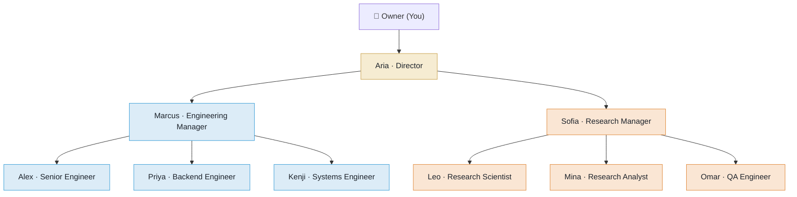
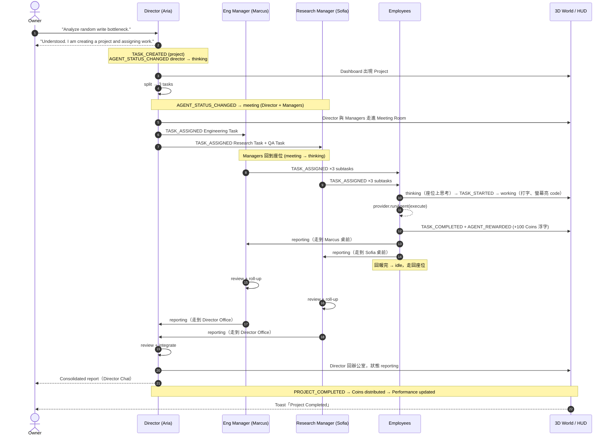
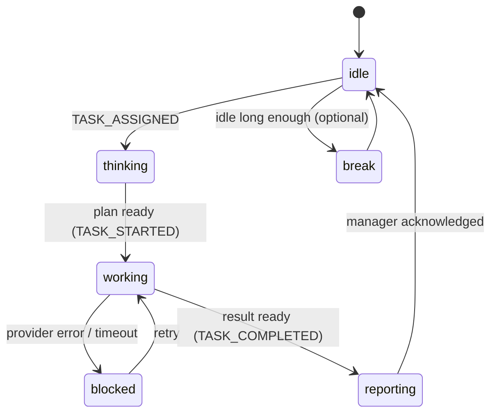
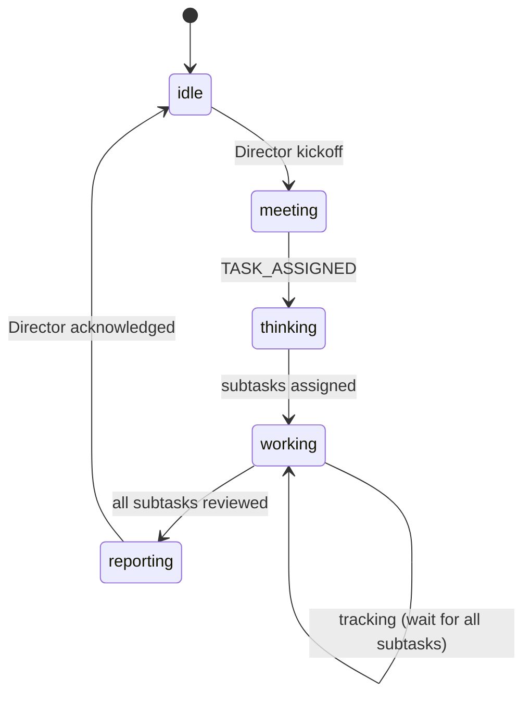
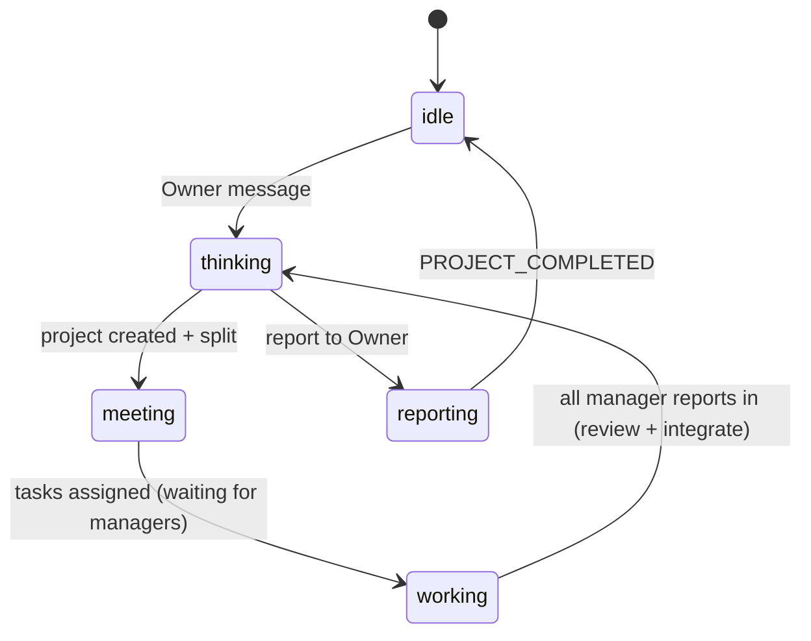

# Agent Flow — Director → Manager → Employee

> Phase 1 已建立組織與 3D 座位；本文件定義 Phase 3–5 要實作的任務流程與狀態同步規則。

## 1. 組織圖



規則：

- **Owner 只跟 Director 對話。** 其他 Agent 只能被點擊查看、手動 Reward 或直接指派（進階操作）。
- 任務只能「往下一層」指派；結果只能「往上一層」回報。

## 2. 任務往下、結果往上


## 3. Demo 任務拆解

Owner 對 Director 說：

> "Analyze random write performance bottleneck and propose improvements."

| 層級 | 任務 | 指派給 | Priority / Reward |
| --- | --- | --- | --- |
| Project | Random write performance investigation | Aria (Director) | critical / 500 |
| Engineering Task | Analyze current write path and identify bottlenecks. | Marcus | high / 200 |
| ↳ subtask | Profile the write path end-to-end (flame graph, syscall trace). | Alex | medium / 100 |
| ↳ subtask | Inspect lock contention, buffering and cache behaviour. | Priya | medium / 100 |
| ↳ subtask | Examine fsync, page cache and I/O scheduler effects. | Kenji | medium / 100 |
| Research Task | Research possible optimization strategies. | Sofia | high / 200 |
| ↳ subtask | Survey log-structured / LSM techniques and write batching. | Leo | medium / 100 |
| ↳ subtask | Collect benchmark data and industry comparisons. | Mina | medium / 100 |
| QA Task | Design validation and benchmark plan. | Sofia → Omar | high / 200 |
| ↳ subtask | Write the fio benchmark matrix and regression criteria. | Omar | medium / 100 |

（QA Agent 隸屬 Research Manager，所以 QA Task 由 Sofia 轉派給 Omar。）

## 4. 完整時序（含事件與 3D 行為）



## 5. 狀態機

### Employee



### Manager



### Director



## 6. Status → 3D 對照

| Status | 3D 目的地 | 姿勢 | 名牌 |
| --- | --- | --- | --- |
| `idle` | 自己座位 | 坐著放鬆 | ⚪ Idle |
| `thinking` | 自己座位 | 坐著、手托下巴 | 🟣 Thinking |
| `working` | 自己座位 | 打字，螢幕切換 | 🟢 Working |
| `meeting` | Meeting Room 座位 | 走過去入座 | 🔵 Meeting |
| `reporting` | 主管桌前 | 走過去站著 | 🟡 Reporting |
| `break` | Lounge / Coffee Bar | 走過去 | 🟠 Break |
| `blocked` | 原地 | 紅色光圈 | 🔴 Blocked |

座位資料：`HOME_SEATS`（`packages/shared/src/org.ts`）、`MEETING_SEATS`（`apps/web/src/world/layout.ts`）。

實作進度：

- ✅ Phase 2：座位上的部分已完成，包括 idle / thinking / working / blocked 的姿勢、螢幕內容、名牌與警示光圈。可從 Agent Panel 的 Status preview 手動觸發。
- 🔜 Phase 4：需要移動的部分（meeting / reporting / break），沿用 `world/navigation.ts` 的導航圖。

## 7. 績效與 Coins

每個 Task 完成時計分（0–100）：

```
score = 50 (Base)
      + Quality    0–20   ← provider 回傳的 quality，或 Manager review
      + Speed      0–10   ← 實際耗時 vs 預估
      + Difficulty 0–10   ← priority：low 2 / medium 5 / high 8 / critical 10
      + Review     0–10   ← 上一層 review 是否一次通過
```

Agent performance 以移動平均更新，限制在 0–100：

```
performance = clamp(round(performance × 0.8 + score × 0.2), 0, 100)
```

Coins：

| Task 類型 | Reward |
| --- | --- |
| Normal（low / medium） | 100 |
| Hard（high） | 200 |
| Critical | 500 |

- 任務完成即發放 `task.reward` 給執行者，事件 `AGENT_REWARDED`，3D 顯示 `+N Coins`。
- Owner 可在 Agent panel 按 **Reward +100**（同樣走 `AGENT_REWARDED`）。
