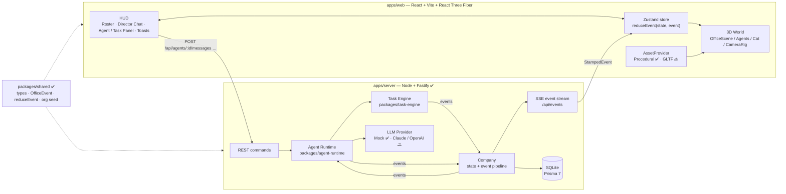
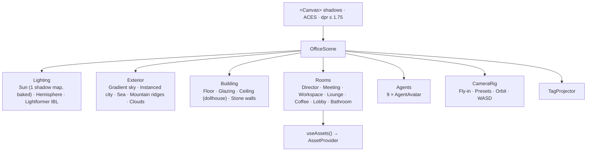
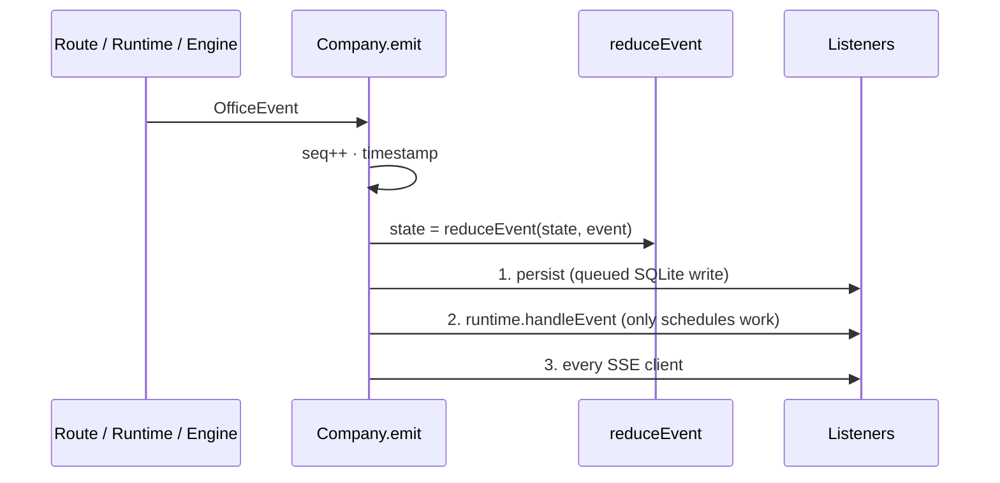
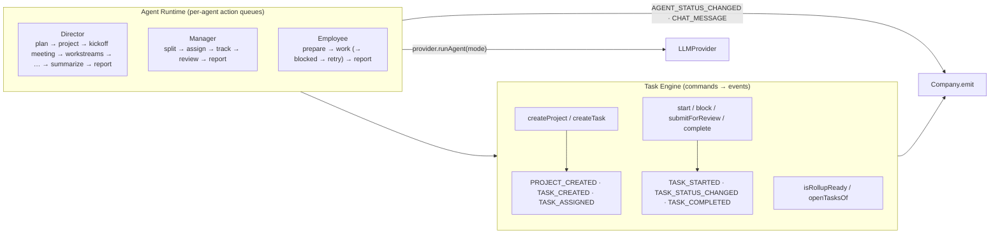
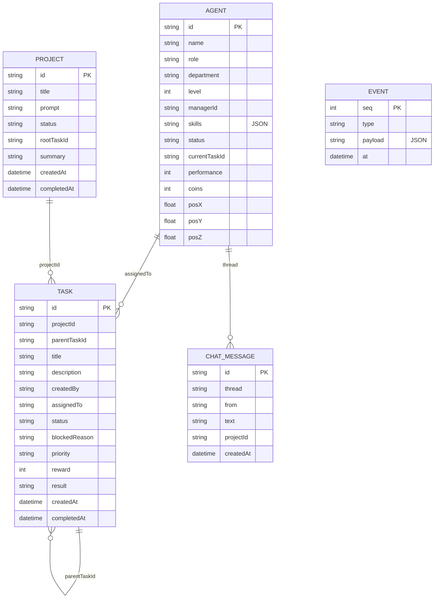

# Architecture — 3D Claude Office

> 狀態標記：✅ 已實作（標示 Phase） · 🔜 規劃中

這份文件描述 MVP 的架構，以及每一層實作到哪裡。核心原則只有一條：

**3D 世界是「公司真實狀態」的投影，不是動畫腳本。**
Agent 的狀態由 server 上的 Agent Runtime 決定，以事件串流到瀏覽器，3D 與 UI 只是把狀態畫出來。Agent 走去會議室，是因為 runtime 把他的 status 改成 `meeting`，而不是前端播了一段預錄動畫。

---

## 1. 系統總覽



| 層 | 位置 | 狀態 |
| --- | --- | --- |
| Shared domain model + reducer | `packages/shared` | ✅ P1 型別、P3 事件與 `reduceEvent` |
| Frontend / HUD | `apps/web/src/ui` | ✅ Roster、View bar（P1）、Agent / Cat Panel（P2）、Director Chat、Task view、Toasts（P3）；Dashboard 🔜 P5 |
| 3D World | `apps/web/src/world`, `agents`, `camera`, `assets` | ✅ P1；狀態姿勢 P2；走動 P4 |
| Backend API + SSE | `apps/server` | ✅ Phase 3 |
| Task Engine | `packages/task-engine` | ✅ Phase 3 |
| Agent Runtime | `packages/agent-runtime` | ✅ Phase 3 |
| LLM Provider | `packages/llm-provider` | ✅ Mock（P3）；Claude / OpenAI 🔜 |
| Event Bus | server `Company` + SSE + 前端 `applyEvent` | ✅ Phase 3（原訂 P4，提前：沒有它無法看到委派過程） |
| Database | `prisma/schema.prisma` + `apps/server/src/db.ts` | ✅ Phase 3 |
| World model（導航圖、目的地、走路時間） | `packages/shared/src/world.ts` | ✅ P2 建立（貓）；P4 移到 shared，前端走動與 runtime 計時共用 |
| Performance / Coins 自動發放 / Dashboard | — | 🔜 Phase 5 |

---

## 2. Frontend（apps/web）

- **React 19 + TypeScript + Vite**：單頁應用。開發時 Vite 把 `/api` proxy 到 Fastify（`:8787`）。
- **Zustand**（`src/store/officeStore.ts`）：前端唯一狀態來源。
  - 公司狀態（agents、tasks、projects、messages）只能由 `applyEvent` 修改，內部呼叫和 server 同一個 `reduceEvent`。
  - 啟動流程：`GET /api/state` 取得快照與 `seq`，再以 `EventSource('/api/events?after=seq')` 接事件。以 `seq` 去重，斷線時瀏覽器自動重連，server 依 `Last-Event-ID` 補送；補不了就送 `resync`，前端重新抓快照。
  - 指令（傳訊息、指派、Reward、Status preview、Reset）只呼叫 REST，**不**直接改本地狀態，結果一律以事件回來。
  - 連不到 server 時顯示 seed 公司與「Server offline」提示，每 4 秒重試。
  - UI 專屬狀態也放在 store：選取 / hover、相機、浮動特效、Toasts、聊天 thread 與未讀數、貓。
- **HUD**（`src/ui`）：
  - 左欄：Brand、Organization roster（即時 status）、**Director Chat**（`ChatPanel.tsx`）。
    - 每位 Agent 一個 thread，Director 是預設 thread。
    - 等待回覆時顯示打字中動畫。
    - 「Project created」訊息下方嵌入即時更新的 Project card（`ProjectCard.tsx`）。
  - 右側：Agent Panel / Task view / Cat Panel（`SidePanel.tsx`）。
    - Agent Panel：Chat、Assign Task（表單）、Reward +100、View Task、Recent tasks、Status preview（dev）。
    - Task view：狀態、優先度、Reward、Assignee、上層任務 / 專案、子任務，以及結果（簡易 markdown，`RichText.tsx`）。
  - 上方 Toasts：Project Completed、指派成功、錯誤、Server offline。
  - 底部 View bar；右下 `?`：操作說明、效能統計、LLM provider、Reset company。
- **Agent 名牌與浮動特效**（`src/agents/tags.tsx`）：
  - 名牌（含貓）與浮字（`+100 Coins`、`✓ Task done`、`♥ purr`）都放在同一個 DOM layer，由 Canvas 內的 `TagProjector` 每幀投影到螢幕座標。
  - 投影在每幀渲染**之後**執行（`addAfterEffect`），用的就是畫面上的相機與 Agent 位置；一般 `useFrame` 會比相機與走路更新早一幀，鏡頭飛行時名牌會落後。
  - 3D 物件透過 `agents/anchors.ts` 註冊 anchor（頭頂上方），名牌、Follow 鏡頭、點擊聚焦都讀同一個即時位置。
  - 有 LOD，且會被不透明牆遮擋。
  - 不使用 drei `<Html>`：React 19 StrictMode 下會遺失 root，每個 root 也有額外成本。

## 3. 3D World



### 3.1 Floor plan

一層樓的 penthouse（40m × 26m，離地約 160m）。座標：`+x = 東`、`-z = 北`。

```
z=-13 ┌──────────── north windows（城市 + 山景）──────────────┐
      │ Director │ Meeting Room │      Lounge       │ Coffee Bar │
z=-6  ├──glass───┴────glass─────┘                   │            │
      │       Engineering pod          Research pod              │ east windows
west  │       (mgr + 3 desks)         (mgr + 3 desks)             │
(海)  ├──────────────────┬──────────────┬───┬──────────────────┤ z=5
      │ Reception lounge │ Elevator core│   │ Premium Bathroom  │
z=13  └──────────────────┴──────────────┴───┴──────────────────┘
```

- 區域、會議座位、相機預設點：`apps/web/src/world/layout.ts`
- 每位 Agent 的 **home seat**（座位與朝向）：`packages/shared/src/org.ts` 的 `HOME_SEATS`。桌椅會依 seat 自動擺放，所以改 seat 就會搬工作站。

### 3.2 Asset abstraction

```ts
interface AssetProvider {
  Desk, Monitor, Chair, Stool, Plant, Sofa, Armchair,
  CoffeeTable, Rug, FloorLamp, Pendant, Bookshelf   // React components
}
```

- 房間只透過 `useAssets()` 取家具，從不自己蓋模型。
- 目前實作：`ProceduralAssets`，全部由 primitive geometry 與 canvas texture 即時產生，**零下載、零二進位素材**。
- 之後可換成 GLTF / Blender / AI-generated provider，用 `<AssetProviderScope provider={...}>` 包起來即可，房間 layout 不用改。
- 規格中的 `getDesk(): Promise<Model>` 在 React Three Fiber 裡的對應寫法是「component + Suspense」：GLTF provider 的 component 內部可以 `useGLTF()`，Suspense 處理非同步載入。

### 3.3 Avatar

- Stylized capsule character（約 1.8k triangles），有髖、膝、肩、頭等關節，可坐、可站、可走路（Phase 4）。
- 外觀（膚色、髮型、衣服、眼鏡）在 `agents/appearance.ts`；部門色在 `agents/status.ts`。
- 坐姿依 status 變化（Phase 2）：idle 放鬆張望、thinking 手托下巴、working 打字、blocked 抱頭 + 紅色警示光圈；收到 `AGENT_REWARDED` 會舉手歡呼。
- 螢幕內容也是 status 的投影：`screenFor(agent)` 依 status 與部門選擇 idle / docs / code / dashboard / error 畫面。
- 投影用 blob shadow（不進 shadow map），因為 shadow map 只算一次（見 §3.5）。

### 3.4 Status → 3D 行為 ✅（坐姿 Phase 2、走動 Phase 4）

| Status | 位置 | 姿勢 / 效果 |
| --- | --- | --- |
| `idle` | 自己座位 | 坐著，螢幕待機桌布 |
| `thinking` | 自己座位 | 坐著、手托下巴，紫色狀態燈 |
| `working` | 自己座位 | 打字動畫，螢幕切換成 code / docs |
| `meeting` | 會議室的固定座位（Aria 坐大螢幕前的主位，其他人依團隊分兩側） | 走進會議室、入座、說話手勢 |
| `reporting` | Employee：主管桌前一排站著；Manager：Director Office 的訪客椅；Director：自己辦公桌旁（對 Owner 報告） | 站著比手勢 / 坐著說話 |
| `break` | 每人固定的位置：Employees 坐 Lounge 沙發或單人椅；Managers 站在 Coffee Bar；Director 站在辦公室窗邊 | 坐下放鬆 / 站著拿咖啡杯 |
| `blocked` | 原地（座位） | 紅色警示光圈 + 名牌閃爍 |
| completed（Task 事件） | 原地 | `✓ Task done` 浮字（`+N Coins` 是 Phase 5） |

#### 一份世界模型，server 與前端共用

移動採 **waypoints + lerp**，不做 NavMesh。Phase 2 為貓建的導航圖在 Phase 4 移到 `packages/shared/src/world.ts`，讓前端（畫出走路）與 agent runtime（算出何時走到）用同一份資料：

- **走道圖**：北側走道 z = -4.3、工作列 z = -1.4、南側走道 z ≈ 3.4、4 條縱向通道、團隊桌之間的通道。線段在交點自動切成節點與邊，用 Dijkstra 找最短路徑。
- **Place**：`placeFor(agent, status)` 回傳 `{ entry, via, position, rotationY, pose }`。
  - `entry` 是走道上的接入點；建圖時自動吸附到最近的邊，離走道超過 0.25 m 就拋錯。
  - `via` 是從走道走進座位的支線（例如繞過會議桌、進 Director Office 的門）。
- **路徑**：`routeBetween(from, to)` = 沿原支線倒退回走道 → 走道最短路徑 → 進入目標支線；同一個房間內直接走過去。
- **走路時間**：`travelSeconds` = 路徑長 / `WALK_SPEED`（1.6 m/s）+ 起身、坐下時間（各 0.45 s）。
- **測試**（`packages/shared/test/world.test.ts`）：
  - 任兩個目的地之間的路徑都不碰到家具（線段與家具矩形相交檢查，留 0.1 m 邊距）。
  - 會影響時間軸的走路有上限（例如去會議室 < 16 s）。
  - 沒有兩個人共用同一個座位或休息位置。
- 網址加 `?nav` 可以看到整張圖：走道（青色）、Agent 目的地支線（琥珀色）、貓的目的地（粉紅）。

#### Server：知道每個人什麼時候走到

- Runtime 每次發出 `AGENT_STATUS_CHANGED` 時，用 `travelSeconds` 記下該 Agent 預計抵達的時間（`location` map；走到一半又改目的地時會累加）。
- 需要「人到了才開始」的步驟會等抵達（`walkTo` / `ctx.until`）：
  - Kickoff meeting：Director 與相關 Managers 全部入座後，才開始 5 秒的會議。
  - 回報：走到主管桌前或 Director Office 之後，才開始 3 秒的回報。
- 所以 server 時間軸和畫面自然一致，前端不需要回報位置；關掉分頁、重新整理或多個分頁同時看都不影響流程。

#### 前端：`AgentMotion`（`agents/motion.ts`）

- 收到新狀態 → `placeFor` → 起身 → 沿路徑以 `WALK_SPEED × SIM_SPEED` 行走（擺手、擺腿、平滑轉向）→ 坐下或站定。
- 走到一半狀態又變：先沿已走過的路退回走道，再前往新目的地。不穿牆、不瞬移。
- 開啟頁面時直接放在目前狀態的位置（例如正在開會的人一開始就坐在會議室）。
- 不限制每幀的 dt，所以即使 FPS 很低，走路時間仍和 server 計算一致。

#### Break

- Employee 完成任務後，約一半機率去休息（依 task id hash，所以結果可重現）。
- 背景排程（`startAmbient`）：每 25–45 秒讓一位閒置的 Employee 或 Manager 去休息，同時最多 2 人在休息。`AMBIENT=0` 可關閉。
- 休息 14–24 秒後回座位；途中被指派任務會立刻走回座位開始工作。

### 3.4.1 Office cat（Phase 2）

`world/cat/OfficeCat.tsx`：獨立於組織之外的 NPC，用來驗證導航圖與跟隨鏡頭。目的地在 `world/cat/catSpots.ts`，路徑用 shared 的 `routeBetween`，只多了跳上沙發的拋物線。

- 行為：簡單的狀態機（stay ↔ walk），依權重隨機選目的地，停留時間依目的地類型（午睡 / 看風景 / 討食 / 拜訪）而定。
- 姿勢：walk / sit / loaf 三組關節目標值，每幀平滑插值。
- 狀態變化（activity、地點）寫入 store，讓 Cat Panel 與名牌同步。
- Follow 鏡頭（`CameraRig`）對任何註冊了 anchor 的物件都適用，Agent 走動時也一樣。

### 3.5 效能策略（目標：桌機 Chrome 約 60 FPS）

| 手段 | 位置 |
| --- | --- |
| **Baked shadow**：shadow map 只在前 3 幀渲染，之後凍結 | `Lighting.tsx › ShadowBaker` |
| 只有 1 個投影光源（太陽），其餘靠 IBL（Lightformer 產生的 env map，不下載 HDRI） | `Lighting.tsx` |
| Instancing：~1,700 棟城市大樓 = 1 draw call；窗框、天花板燈條、木格柵都是 instanced | `StaticInstances` |
| Geometry merge：椅子、桌框、螢幕、植物、書櫃各自合併成 1–2 個 mesh（vertex colors 共用材質） | `mergeParts` |
| 共用 material / geometry / texture 單例 | `assets/materials.ts`, `primitives.tsx` |
| 天花板在相機高於屋頂時自動隱藏（dollhouse） | `Building.tsx › CeilingGroup` |
| 真鏡面反射只在相機進入浴室時啟用，其他時候用 env-map 替身 | `Bathroom.tsx › Mirror` |
| `dpr` 上限 1.75；不用 transmission / postprocessing | `App.tsx` |

實測（Phase 1，overview 全景）：約 **620 draw calls / 310k triangles**；室內視角約 40–300 draw calls。可按 `P` 隨時查看。

---

## 4. Backend（apps/server）✅ Phase 3

Node 22 + TypeScript（以 `tsx` 執行，不需 build）+ Fastify 5。

| Method | Path | 說明 |
| --- | --- | --- |
| `GET` | `/api/health` | `{ ok, provider, seq }` |
| `GET` | `/api/state` | 快照：`{ seq, provider, state }` |
| `GET` | `/api/events?after=seq` | SSE 事件串流；支援 `Last-Event-ID` 重播，缺口過大送 `resync` |
| `POST` | `/api/agents/:id/messages` | Owner 對 Agent 說話 `{ text }`；對 Director 說話就是發起工作 |
| `POST` | `/api/agents/:id/tasks` | Assign Task `{ title, description?, priority? }` |
| `POST` | `/api/agents/:id/reward` | Reward `{ coins }`（1–1000，預設 100） |
| `POST` | `/api/dev/agents/:id/status` | Status preview（開發用，強制設定狀態） |
| `POST` | `/api/admin/reset` | 重設公司（清空專案、任務、聊天） |

- 指令回 `202 Accepted`；真正的結果以事件經 SSE 回到所有開著的瀏覽器（多個分頁看到的是同一間公司）。
- `npm run build` 之後，`npm start` 會在同一個 port（`:8787`）同時提供 API 與 `apps/web/dist`（SPA fallback）。
- 設定（環境變數，全部可選）：

| 變數 | 預設 | 說明 |
| --- | --- | --- |
| `PORT` / `HOST` | `8787` / `127.0.0.1` | 監聽位址 |
| `DATABASE_URL` | `file:./office.db` | SQLite 檔（相對 `apps/server`） |
| `LLM_PROVIDER` | `mock` | `claude` / `openai` 尚未實作，會退回 Mock 並警告 |
| `SIM_SPEED` | `1` | 模擬速度倍率（思考時間與走路 / 開會停頓都會縮短） |
| `MOCK_BLOCK_RATE` | `0.1` | 非 Demo 任務第一次執行時遇到 Blocked 的機率 |
| `AMBIENT` | `1` | `0` = 關閉閒置 Agent 自動去休息 |
| `SERVE_WEB` | `1` | `0` = 不提供前端靜態檔 |

### 4.1 事件管線（`src/company.ts`）



- `emit` 可重入：處理某事件時又發出的事件會排進佇列，依序處理，所以所有 listener 看到的順序完全相同。
- 記憶體保留最近 5,000 個事件，供 SSE 重連時補送。

### 4.2 重啟後恢復

`tsx watch` 在開發時常重啟，執行中的 Promise 會消失。`runtime.resume()` 在啟動時：

1. 把所有 Agent 設回 idle。
2. 依建立時間重新驅動每個未完成的任務：
   - Employee 的任務：重做。
   - 子任務都完成的父任務：進行 review / 結案。
   - 尚未拆解的 Manager 任務：重新拆解。
3. 已實測：在專案進行中 `kill -9` server，重啟後 5 個未完成任務被接手，專案正常結束。

## 5. Agent Runtime & Task Engine ✅ Phase 3



- **Task Engine**（`packages/task-engine`）：
  - 只負責驗證狀態轉換並發出事件，從不直接修改狀態。
  - 合法轉換：`backlog → assigned → working ⇄ blocked`、`working → review → completed`、`working → completed`；其他轉換一律拋錯。
  - 任務建立時依優先度設定 `reward`：low / medium 100、high 200、critical 500。
- **Agent Runtime**（`packages/agent-runtime`）：
  - 每位 Agent 有一條序列化的 action queue。行為是短腳本：改狀態 → 一次 provider 呼叫 → engine 指令。不是長時間自主迴圈。
  - 觸發來源只有事件：
    - `TASK_ASSIGNED` 給 Manager → 拆解；給 Employee → 執行。
    - `TASK_COMPLETED` 且兄弟任務都完成 → 上層 review。若上層是專案根任務，則由 Director 整合並回報。
  - 動作之間的狀態：有未完成任務 → `working`（追蹤中），否則 `idle`。
  - Director 不會自己做工作：`plan` 的結果只能是交給 Manager 的工作流，最後再 `summarize`。
  - Owner 訊息分類（Director）：
    - 問候 → 聊天回覆。
    - 問進度（status / progress / 進度…）→ 由 runtime 依實際任務計算回覆。
    - 其他 → 建立專案。
  - Owner 直接指派（Assign Task）：Director → 開專案；其他人 → 建立 `createdBy: owner` 的任務，完成後在該 Agent 的 thread 回報。
  - Reset：`COMPANY_RESET` 讓 generation +1，所有進行中的 action 在下一步自動取消。
- 停頓（`PAUSE`，speed 1）：開會 5 s、回報 3 s、Blocked 5 s，都從人走到定位後才開始計時（§3.4）。整個 Demo 約 2 分鐘（Phase 3 沒有走路時約 40 秒）；`SIM_SPEED=2` 約 1 分鐘。
- 測試：`npm test` 在記憶體中以 40× 速度跑完整 Demo，檢查：
  - 委派順序與任務指派對象。
  - 每個任務都有結果。
  - 狀態序列（Director 有 meeting / reporting、Kenji 有 blocked）。
  - Owner 只收到 Director 的三則訊息。

## 6. Event Bus ✅ Phase 3

事件型別在 `packages/shared/src/events.ts`，server 與 web 共用：

```ts
type OfficeEvent =
  | { type: 'PROJECT_CREATED'; project: Project }
  | { type: 'TASK_CREATED'; task: Task }
  | { type: 'TASK_ASSIGNED'; taskId: string; agentId: string }
  | { type: 'TASK_STARTED'; taskId: string; agentId: string }
  | { type: 'TASK_STATUS_CHANGED'; taskId: string; status: TaskStatus; reason?: string }
  | { type: 'TASK_COMPLETED'; taskId: string; agentId: string; result: string; completedAt: string; score?: number }
  | { type: 'AGENT_STATUS_CHANGED'; agentId: string; status: AgentStatus; taskId?: string | null }
  | { type: 'AGENT_REWARDED'; agentId: string; coins: number; reason: string }
  | { type: 'CHAT_MESSAGE'; message: ChatMessage }
  | { type: 'PROJECT_COMPLETED'; projectId: string; summary: string; completedAt: string }
  | { type: 'COMPANY_RESET'; state: CompanyState }

type StampedEvent = { seq: number; at: string; event: OfficeEvent }
```

規格要求的 7 個事件都有，另外加了：

| 事件 | 用途 |
| --- | --- |
| `PROJECT_CREATED` | Dashboard / Project card |
| `TASK_STATUS_CHANGED` | review、blocked |
| `CHAT_MESSAGE` | Director Chat |
| `COMPANY_RESET` | 重設公司 |

`score` 在 Phase 5 填入。

## 7. Database ✅ Phase 3

- **Prisma 7** + `@prisma/adapter-better-sqlite3`（driver adapter，不需要 Rust query engine）。
- Schema 在 `prisma/schema.prisma`，config 在 `apps/server/prisma.config.ts`。
- Client 產生在 `apps/server/src/generated/prisma`（git-ignored）。
- `npm run dev` / `npm start` 會先自動執行 `prisma generate && prisma db push`，不需要手動 migrate。
- 寫入策略（`src/db.ts`）：每個事件寫入它影響到的實體列（upsert 最新狀態），並 append 到 `Event` 表。寫入依事件順序排隊，失敗只記 log，不影響模擬。
- 啟動時從實體表載入狀態；資料庫是空的就寫入 seed 組織。



## 8. LLM Provider ✅ Mock（Phase 3）

```ts
interface LLMProvider {
  readonly name: string
  runAgent(input: AgentRunInput): Promise<AgentRunResult>
}

type AgentRunMode = 'plan' | 'split' | 'prepare' | 'execute' | 'review' | 'summarize' | 'chat'

type AgentRunInput = {
  agent: Agent
  mode: AgentRunMode
  prompt?: string                                   // Owner's words (plan / chat)
  task?: Task
  team?: Agent[]                                    // who can be delegated to (plan / split)
  childResults?: { agent: Agent; task: Task }[]     // review / summarize
  attempt?: number                                  // execute retries after a block
  projectPrompt?: string
  projectTitle?: string
}

type AgentRunResult = {
  text: string
  title?: string                                    // plan: project title
  work?: { title; description; assignee; priority }[] // plan / split
  blocked?: string                                  // execute: cannot continue yet
}
```

- **MockProvider**（預設，`packages/llm-provider/src/mock.ts`）：
  - 依角色與 mode 回傳模板，並模擬延遲（例如 execute 6–10 s）。
  - Demo 題目（含 "random write"）使用手寫的完整內容：3 個工作流、6 個子任務、各自的技術結果、Manager review 與 Director 最終報告。Kenji 第一次執行會刻意遇到 Blocked。
  - 其他題目使用以主題為基礎的通用模板。
- **Claude / OpenAI**：介面已固定，只需新增一個實作並在 `createProvider` 註冊（`LLM_PROVIDER=claude`）。

## 9. Repository 結構與取捨

- npm workspaces（不引入 Turborepo / Nx）。
- 共 6 個 workspace：`apps/web`、`apps/server`、`packages/{shared,llm-provider,task-engine,agent-runtime}`。
- 各 package 直接 export TypeScript source（`main: src/index.ts`），Vite 與 `tsx` 都能直接使用，不需要 build step。
- `npm run dev` 用 `concurrently` 同時啟動 server（`tsx watch`）與 web（Vite）。
- 依賴方向：`shared` ← `llm-provider`、`task-engine` ← `agent-runtime` ← `server`。web 只依賴 `shared`。
