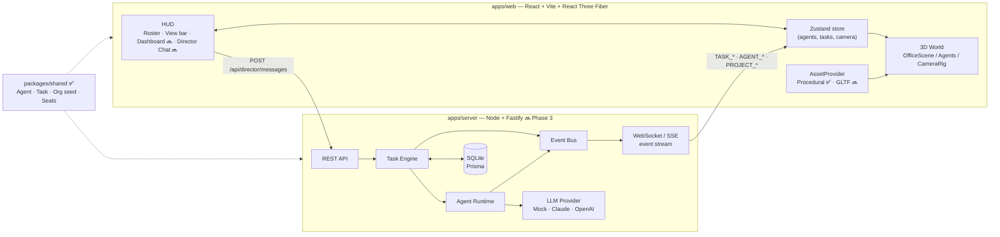
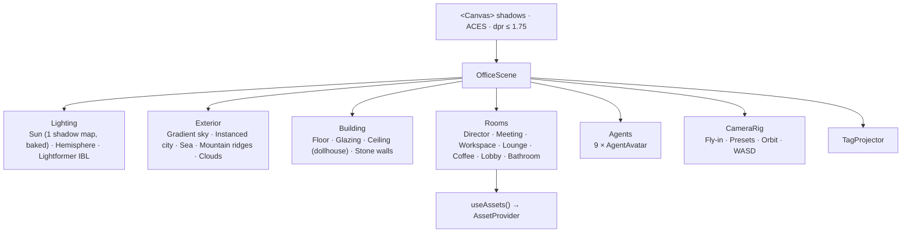
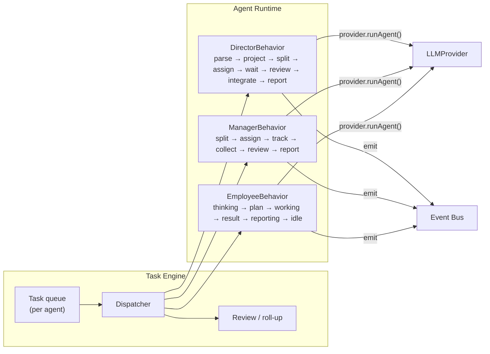
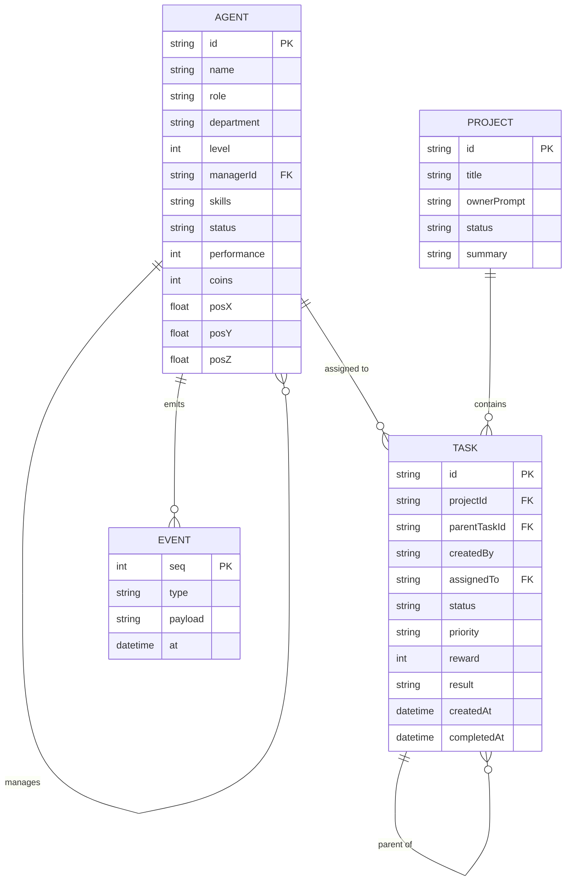

# Architecture — 3D Claude Office

> 狀態標記：✅ 已實作（Phase 1） · 🔜 規劃中（標示預計 Phase）

這份文件描述整個 MVP 的目標架構，以及目前每一層實作到哪裡。核心原則只有一條：

**3D 世界是「公司真實狀態」的投影，不是動畫腳本。**
Agent 走去會議室，是因為 Task Engine 把他的 status 改成 `meeting`，而不是因為前端播放了一段預錄動畫。

---

## 1. 系統總覽



| 層 | 位置 | 狀態 |
| --- | --- | --- |
| Shared domain model | `packages/shared` | ✅ Phase 1 |
| Frontend / HUD | `apps/web/src/ui` | ✅ Roster、View bar、Stats（P1）、Agent / Cat Panel（P2）；Chat / Dashboard 🔜 |
| 3D World | `apps/web/src/world`, `agents`, `camera`, `assets` | ✅ Phase 1 |
| Backend API | `apps/server` | 🔜 Phase 3 |
| Task Engine | `packages/task-engine` | 🔜 Phase 3 |
| Agent Runtime | `packages/agent-runtime` | 🔜 Phase 3 |
| LLM Provider | `packages/llm-provider` | 🔜 Phase 3（Mock 優先） |
| Event Bus | server 內 + 前端 store | 前端 `applyEvent` ✅ Phase 2；server 端 🔜 Phase 4 |
| Navigation graph | `apps/web/src/world/navigation.ts` | ✅ Phase 2（貓使用；Agent 走動 Phase 4） |
| Database | `prisma/` | 🔜 Phase 3 |

---

## 2. Frontend（apps/web）

- **React 19 + TypeScript + Vite**：單頁應用。
- **Zustand**（`src/store/officeStore.ts`）：唯一的前端狀態來源，存放 agents、選取 / hover、相機鏡頭與跟隨、浮動特效、貓的狀態、效能統計。
  - 公司狀態（agents 的 status、coins…）**只能**經由 `applyEvent(OfficeEvent)` 修改（見 §6）。
  - Phase 2 由 `dispatch()` 在前端直接呼叫 `applyEvent`，例如 Reward +100、Status preview。Phase 3 只要把 `dispatch` 換成呼叫 API，再把 server 事件串流接到 `applyEvent`。
- **HUD**（`src/ui/Hud.tsx`）：一般 DOM，疊在 Canvas 上。
  - Organization roster：Owner → Director → Managers → Employees，即時顯示 status；hover 會在 3D 中亮出該 Agent 的部門光圈，點擊飛到該 Agent。
  - View bar：8 個相機預設點（Overview、Workspace、Director、Meeting Room、Lounge、Coffee Bar、Bathroom、City View）。
  - Performance stats（按 `P`）：FPS、draw calls、triangles。
  - Agent Panel / Cat Panel（`src/ui/SidePanel.tsx`）：點擊 Agent 或貓時出現；`StatusBadge` 是 Roster、Panel、名牌共用的狀態元件。
- **Agent 名牌與浮動特效**（`src/agents/tags.tsx`）：所有名牌（含貓）與 `+100 Coins` 之類的浮字放在同一個 DOM layer，由 Canvas 內的 `TagProjector` 每幀投影到螢幕座標。
  - 有 LOD：近距離顯示完整卡片（Name / Role / Status），遠距離縮成膠囊，從高空完全隱藏。
  - 會被不透明牆（浴室、電梯核心、隔間牆）遮擋，玻璃不會。
  - 不使用 9 個 drei `<Html>` root：React 19 StrictMode 下會遺失 root，且每個 root 都有額外成本。

## 3. 3D World



### 3.1 Floor plan

一層樓的 penthouse（40m × 26m，離地約 160m）。座標：`+x = 東`、`-z = 北`。

```
z=-13 ┌──────────── north windows（城市 + 山景）──────────────┐
      │ Director │ Meeting Room │      Lounge       │ Coffee Bar │
z=-6  ├──glass───┴────glass─────┘                   │            │
      │       Engineering pod          Research pod              │ east windows
west  │       (mgr + 3 desks)         (mgr + 3 desks)             │
(海)  ├──────────────────┬──────────────┬───┬──────────────────┤ z=5
      │ Reception lounge │ Elevator core│   │ Premium Bathroom  │
z=13  └──────────────────┴──────────────┴───┴──────────────────┘
```

- 區域、會議座位、相機預設點：`apps/web/src/world/layout.ts`
- 每位 Agent 的 **home seat**（座位與朝向）：`packages/shared/src/org.ts` 的 `HOME_SEATS`。桌椅會依 seat 自動擺放，所以改 seat 就會搬工作站。

### 3.2 Asset abstraction

```ts
interface AssetProvider {
  Desk, Monitor, Chair, Stool, Plant, Sofa, Armchair,
  CoffeeTable, Rug, FloorLamp, Pendant, Bookshelf   // React components
}
```

- 房間只透過 `useAssets()` 取家具，從不自己蓋模型。
- 目前實作：`ProceduralAssets`，全部由 primitive geometry 與 canvas texture 即時產生，**零下載、零二進位素材**。
- 之後可換成 GLTF / Blender / AI-generated provider，用 `<AssetProviderScope provider={...}>` 包起來即可，房間 layout 不用改。
- 規格中的 `getDesk(): Promise<Model>` 在 React Three Fiber 裡的對應寫法是「component + Suspense」：GLTF provider 的 component 內部可以 `useGLTF()`，Suspense 處理非同步載入。

### 3.3 Avatar

- Stylized capsule character（約 1.8k triangles），有髖、膝、肩、頭等關節，可坐、可站，之後可走路。
- 外觀（膚色、髮型、衣服、眼鏡）在 `agents/appearance.ts`；部門色在 `agents/status.ts`。
- 坐姿依 status 變化（Phase 2）：idle 放鬆張望、thinking 手托下巴、working 打字、blocked 抱頭 + 紅色警示光圈；收到 `AGENT_REWARDED` 會舉手歡呼。
- 螢幕內容也是 status 的投影：`screenFor(agent)` 依 status 與部門選擇 idle / docs / code / dashboard / error 畫面。
- 投影用 blob shadow（不進 shadow map），因為 shadow map 只算一次（見 §3.5）。

### 3.4 Status → 3D 行為（Phase 4 實作）

| Status | 位置 | 姿勢 / 效果 |
| --- | --- | --- |
| `idle` | 自己座位 | 坐著，螢幕待機桌布 |
| `thinking` | 自己座位 | 坐著、手托下巴，紫色狀態燈 |
| `working` | 自己座位 | 打字動畫，螢幕切換成 code / docs |
| `meeting` | `MEETING_SEATS` | 走到會議室入座 |
| `reporting` | 主管座位旁 | 走到主管桌前站著 |
| `break` | Lounge / Coffee Bar | 走過去坐下或站在吧台 |
| `blocked` | 原地 | 紅色警示光圈 + 名牌閃爍 |
| completed（Task 事件） | 原地 | `+N Coins` 浮字、完成動畫 |

移動採 **waypoints + lerp**，不做 NavMesh。Phase 2 已建立導航圖（`world/navigation.ts`）：

- **走道節點**：北側走道 z = -4.3、南側走道 z ≈ 3.3，加上 4 條縱向通道；邊都避開家具與牆。
- **目的地（Spot）**：每個目的地掛在一個節點上，透過一小段 `via` 支線進入。
- **路徑** = 退出目前支線 → 走道 BFS → 進入目標支線；高度差超過 0.2 m 的段落以拋物線跳躍（貓跳上沙發）。
- 網址加 `?nav` 可以看到整張圖。
- Phase 4 只需要為會議室座位、主管桌前、休息區加上 Spot，Agent 就能共用同一套路徑。

### 3.4.1 Office cat（Phase 2）

`world/cat/OfficeCat.tsx`：獨立於組織之外的 NPC，用來驗證導航圖與跟隨鏡頭。

- 行為：簡單的狀態機（stay ↔ walk），依權重隨機選目的地，停留時間依目的地類型（午睡 / 看風景 / 討食 / 拜訪）而定。
- 姿勢：walk / sit / loaf 三組關節目標值，每幀平滑插值。
- 狀態變化（activity、地點）寫入 store，讓 Cat Panel 與名牌同步。
- Follow 鏡頭（`CameraRig`）對任何註冊了 anchor 的物件都適用，所以之後也能跟隨 Agent。

### 3.5 效能策略（目標：桌機 Chrome 約 60 FPS）

| 手段 | 位置 |
| --- | --- |
| **Baked shadow**：shadow map 只在前 3 幀渲染，之後凍結 | `Lighting.tsx › ShadowBaker` |
| 只有 1 個投影光源（太陽），其餘靠 IBL（Lightformer 產生的 env map，不下載 HDRI） | `Lighting.tsx` |
| Instancing：~1,700 棟城市大樓 = 1 draw call；窗框、天花板燈條、木格柵都是 instanced | `StaticInstances` |
| Geometry merge：椅子、桌框、螢幕、植物、書櫃各自合併成 1–2 個 mesh（vertex colors 共用材質） | `mergeParts` |
| 共用 material / geometry / texture 單例 | `assets/materials.ts`, `primitives.tsx` |
| 天花板在相機高於屋頂時自動隱藏（dollhouse） | `Building.tsx › CeilingGroup` |
| 真鏡面反射只在相機進入浴室時啟用，其他時候用 env-map 替身 | `Bathroom.tsx › Mirror` |
| `dpr` 上限 1.75；不用 transmission / postprocessing | `App.tsx` |

實測（Phase 1，overview 全景）：約 **620 draw calls / 310k triangles**；室內視角約 40–300 draw calls。可按 `P` 隨時查看。

---

## 4. Backend（apps/server）🔜 Phase 3

- **Node.js + TypeScript + Fastify**。
- 對外 API（草案）：

| Method | Path | 說明 |
| --- | --- | --- |
| `GET` | `/api/state` | 初始快照：agents、tasks、projects |
| `POST` | `/api/director/messages` | Owner 對 Director 說話（建立 Project） |
| `POST` | `/api/agents/:id/reward` | Owner 手動 Reward +100 |
| `POST` | `/api/agents/:id/tasks` | 直接指派任務（Agent panel 的 Assign Task） |
| `GET` | `/api/events` (WS / SSE) | 事件串流 |

- Server 是 **single source of truth**。前端可以斷線重連：先拿 `/api/state` 快照，再接事件串流。

## 5. Agent Runtime & Task Engine 🔜 Phase 3



- **Task Engine** 負責：Task 狀態機（`backlog → assigned → working → review → completed`，另有 `blocked`）、父子任務關係（`parentTaskId`）、子任務全部完成時觸發父任務 review、計分與發幣。
- **Agent Runtime** 負責：依角色（level）執行行為腳本。行為是 **簡單的狀態機 + 一次 LLM 呼叫**，不是長時間自主 agent loop。
- Director 不可以自己執行所有工作：DirectorBehavior 只能產生「交給 Manager 的任務」與「最後的整合報告」。

## 6. Event Bus 🔜 Phase 4

```ts
type OfficeEvent =
  | { type: 'TASK_CREATED'; task: Task }
  | { type: 'TASK_ASSIGNED'; taskId: string; agentId: string }
  | { type: 'TASK_STARTED'; taskId: string; agentId: string }
  | { type: 'TASK_COMPLETED'; taskId: string; result: string; score: number }
  | { type: 'AGENT_STATUS_CHANGED'; agentId: string; status: AgentStatus; taskId?: string }
  | { type: 'AGENT_REWARDED'; agentId: string; coins: number; reason: string }
  | { type: 'PROJECT_COMPLETED'; projectId: string; summary: string }
```

- Server 端：in-process typed EventEmitter；每個事件同時寫入 DB（`Event` 表，可重播）並推送到 WebSocket。
- 前端：`applyEvent(event)` 是唯一修改 agents / tasks 的入口 → 3D、HUD、Dashboard 自動同步。
- 事件型別放在 `packages/shared`，前後端共用。

## 7. Database 🔜 Phase 3

SQLite + Prisma（`prisma/schema.prisma`）。



## 8. LLM Provider 🔜 Phase 3

```ts
interface LLMProvider {
  runAgent(input: AgentRunInput): Promise<AgentRunResult>
}

type AgentRunInput = {
  agent: Agent
  task: Task
  mode: 'plan' | 'split' | 'execute' | 'review' | 'summarize'
  context: { parent?: Task; childResults?: { agent: Agent; task: Task }[] }
}

type AgentRunResult = {
  text: string
  subtasks?: { title: string; description: string; assignee: string; priority: TaskPriority }[]
  quality?: number // 0–20, feeds the Quality Bonus
}
```

| Provider | 用途 |
| --- | --- |
| `MockProvider` | **預設**。依角色回傳模板內容，延遲 1.5–4 秒；完整流程不需要任何 API key。 |
| `ClaudeProvider` | 有 `ANTHROPIC_API_KEY` 時啟用 |
| `OpenAIProvider` | 有 `OPENAI_API_KEY` 時啟用 |

選擇方式：環境變數 `LLM_PROVIDER=mock|claude|openai`，缺 key 時自動退回 Mock。

## 9. Repository 結構與取捨

- 使用 **npm workspaces**（不引入 Turborepo / Nx）。目前 workspaces 只有 `apps/web`、`packages/shared`；其他資料夾在對應 Phase 開始時才加入，避免建立沒用到的抽象。
- `packages/shared` 直接 export TypeScript source（`main: src/index.ts`），Vite 與之後的 `tsx` 都能直接吃，不需要 build step。
- 如果 Phase 3 發現 `agent-runtime / task-engine / llm-provider` 分成三個 package 太重，會先放在 `apps/server/src/*` 下，介面穩定後再抽出。
